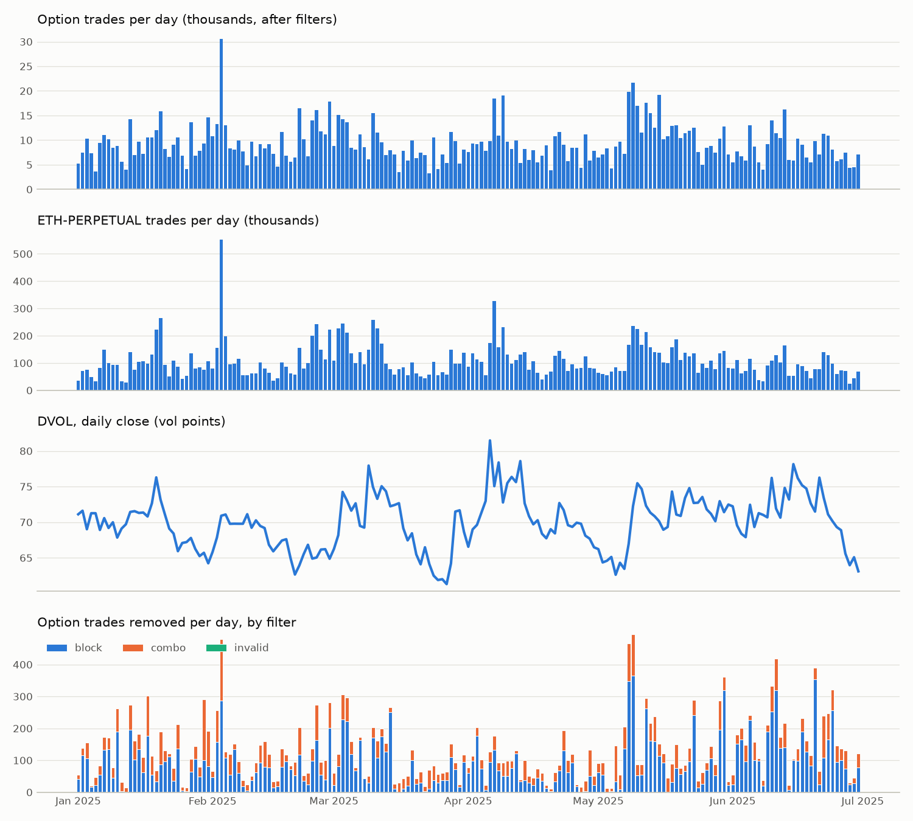

# Phase 1 data report

Generated by `uv run python -m mm.data.cli report --config config/base.yaml`. Do not edit
by hand; the interpretation is in `reports/phase1_data_notes.md`.

Study period 2025-01-01 to 2025-07-01 (end exclusive), 181 UTC days.

## Totals

| | value |
|---|---|
| option trades kept | 1,694,296 |
| of which flagged suspect | 17,407 |
| perp trades | 19,546,166 |
| dated-future trades | 6,033,854 |
| option trades removed | {"drop_duplicate": 0, "drop_block": 16082, "drop_combo": 7392, "drop_bad_instrument": 0, "drop_invalid": 0} |
| median option trades/day | 8,643 |
| median perp trades/day | 96,239 |

## Days with no trades in a stream

_none_

## Days with DVOL or funding not exactly 24 hourly rows

_none_

## Low-activity days (below 40% of the median, options or perp)

| date | weekday | n_opt | n_perp | dvol |
|---|---|---|---|---|
| 2025-01-01 | Wed | 5180 | 34540 | 0.711 |
| 2025-01-05 | Sun | 3600 | 31998 | 0.713 |
| 2025-01-11 | Sat | 5578 | 33905 | 0.691 |
| 2025-01-12 | Sun | 4051 | 27574 | 0.697 |
| 2025-02-15 | Sat | 7212 | 35131 | 0.659 |
| 2025-03-23 | Sun | 3237 | 58266 | 0.641 |
| 2025-06-07 | Sat | 5446 | 38087 | 0.713 |
| 2025-06-08 | Sun | 4000 | 32529 | 0.71 |
| 2025-06-28 | Sat | 4403 | 23422 | 0.64 |

## Longest gap between consecutive trades within a day (seconds)

Options:

| date | weekday | n_opt | max_gap_opt_s |
|---|---|---|---|
| 2025-03-06 | Thu | 8091 | 1711.232 |
| 2025-06-10 | Tue | 14004 | 1145.426 |
| 2025-04-18 | Fri | 6789 | 1005.705 |
| 2025-06-14 | Sat | 5961 | 947.227 |
| 2025-04-12 | Sat | 9882 | 923.172 |

Perpetual:

| date | weekday | n_perp | max_gap_perp_s |
|---|---|---|---|
| 2025-03-06 | Thu | 100247 | 1669.291 |
| 2025-06-10 | Tue | 109597 | 1125.743 |
| 2025-01-08 | Wed | 99177 | 804.817 |
| 2025-02-04 | Tue | 198352 | 742.475 |
| 2025-04-01 | Tue | 86471 | 716.175 |

## Exchange-wide pauses (perp silent for more than 5 minutes)

`option_gap_min` is the longest option-trade gap overlapping the pause.

| perp_last | perp_next | weekday | perp_gap_min | option_gap_min |
|---|---|---|---|---|
| 2025-01-08 09:00:00 | 2025-01-08 09:13:24 | Wed | 13.4 | 14.0 |
| 2025-02-04 09:00:00 | 2025-02-04 09:12:22 | Tue | 12.4 | 13.7 |
| 2025-02-09 02:55:08 | 2025-02-09 03:00:14 | Sun | 5.1 | 0.8 |
| 2025-02-16 04:50:49 | 2025-02-16 04:57:01 | Sun | 6.2 | 4.4 |
| 2025-03-06 09:00:15 | 2025-03-06 09:28:04 | Thu | 27.8 | 28.5 |
| 2025-04-01 08:59:50 | 2025-04-01 09:11:46 | Tue | 11.9 | 15.1 |
| 2025-04-05 22:23:40 | 2025-04-05 22:30:02 | Sat | 6.4 | 9.2 |
| 2025-04-15 08:59:49 | 2025-04-15 09:10:31 | Tue | 10.7 | 13.0 |
| 2025-04-23 14:09:52 | 2025-04-23 14:18:26 | Wed | 8.6 | 11.2 |
| 2025-05-13 09:00:01 | 2025-05-13 09:09:45 | Tue | 9.7 | 9.9 |
| 2025-06-10 08:59:59 | 2025-06-10 09:18:45 | Tue | 18.8 | 19.1 |
