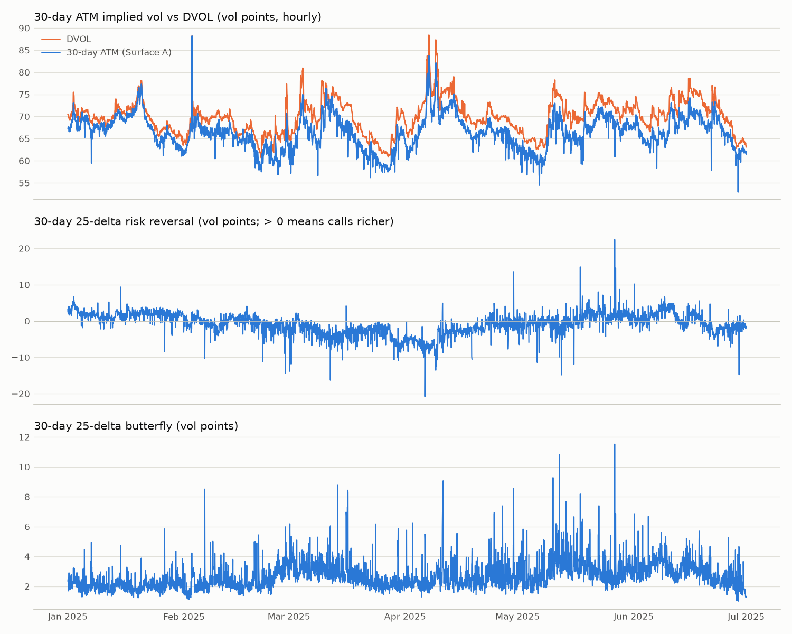

# Phase 3: Surface A (eSSVI on Deribit mark IVs)

Generated by `uv run python -m mm.surface.report --config config/base.yaml`.
52,128 refits every 300 s; 525,432 expiry fits.

## Result: PASS

| check | result | target | |
|---|---|---|---|
| fit error | see table below | per expiry bucket | ✅ |
| arbitrage-free refits on normal days | 99.1% | ≥ 95% | ✅ |
| 30d ATM vs DVOL, daily-change correlation | 0.858 | ≥ 0.6 | ✅ |
| hours with DVOL − 30d ATM in [0, 8] vol points | 99.0% | ≥ 95% | ✅ |

Normal day: |daily DVOL change| < 3.15 vol points (the 90%
quantile of the training period, up to 2025-04-29).
DVOL − 30d ATM: mean 3.40, std 1.43 vol points (DVOL is a
variance-swap-style index, so it sits above ATM by construction).
Hourly-change correlation 0.377, for information only: hourly DVOL moves
(std 0.64 vol points) are small next to the sampling noise of
a surface fitted to trade-time marks, so the daily check is used instead (D026).

## Fit error (vega- and recency-weighted RMSE of full fits, vol points)

| expiry days | fits | median | p95 | target median | target p95 | pass |
|---|---|---|---|---|---|---|
| (0, 2] | 93,456 | 1.056 | 3.188 | 1.250 | 4.000 | ✅ |
| (2, 8] | 82,336 | 0.694 | 2.480 | 0.750 | 3.000 | ✅ |
| (8, 35] | 101,354 | 0.330 | 1.548 | 0.400 | 2.000 | ✅ |
| (35, 100] | 61,289 | 0.229 | 1.024 | 0.300 | 1.500 | ✅ |
| (100, 10000] | 34,409 | 0.155 | 0.876 | 0.300 | 1.500 | ✅ |

## By expiry: fit error and ladder usage

| expiry days | full_fits | median | p95 | share carry | share full | share none |
|---|---|---|---|---|---|---|
| (0, 2] | 93,456 | 1.056 | 3.188 | 0.062 | 0.934 | 0.004 |
| (2, 8] | 82,336 | 0.694 | 2.480 | 0.067 | 0.925 | 0.008 |
| (8, 35] | 101,354 | 0.330 | 1.548 | 0.165 | 0.798 | 0.037 |
| (35, 100] | 61,289 | 0.229 | 1.024 | 0.259 | 0.634 | 0.107 |
| (100, 10000] | 34,409 | 0.155 | 0.876 | 0.308 | 0.305 | 0.387 |

## Fit guards (D025)

- Warm-started fits retried from cold starts and improved: 20,550
- Fits rejected (RMSE > 5 vol points): 3,822

## Arbitrage

- Refits with a butterfly flag: 0.00% (all days)
- Refits with a calendar flag: 0.90% (all days)

Days with the lowest share of clean refits:

| day | share clean |
|---|---|
| 2025-06-27 | 0.938 |
| 2025-04-17 | 0.948 |
| 2025-01-05 | 0.958 |
| 2025-06-26 | 0.969 |
| 2025-03-30 | 0.969 |
| 2025-05-16 | 0.969 |
| 2025-04-30 | 0.972 |
| 2025-01-29 | 0.972 |

