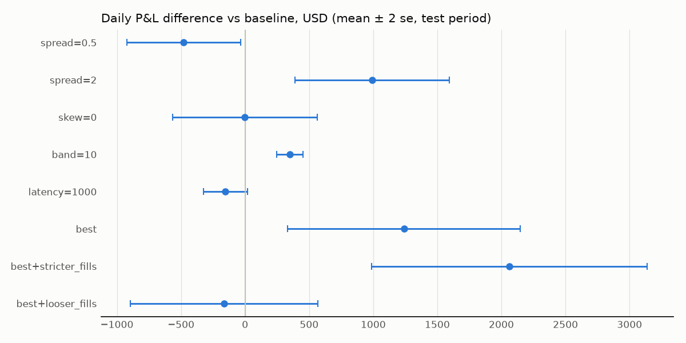

# Phase 8: experiment results (test period 2025-04-29 to 2025-07-01)

Generated by `uv run python -m mm.run --config config/base.yaml --experiments config/experiments.yaml`.
USD. Each variant changes one parameter of the baseline (`config/base.yaml`); "best"
combines the best value of each selectable experiment, chosen on the **training period**
(2025-01-01 to 2025-04-29) by mean daily P&L. Paired difference =
mean of daily (variant − baseline) ± 2 standard errors over the 63 test days
(ac1: lag-1 autocorrelation of the daily differences; if large, the error bar is too
narrow). Stress days: daily mean DVOL ≥ 0.7, the
80% quantile of training days (23 of
63 test days).

## Results

| variant | total | mean/day | Sharpe | max DD | calm/day | stress/day | Δ vs base/day | Δ calm | Δ stress | ac1 | fills | vol share | hedges | 1h markout (vp) | vega/limit (mean abs) | gamma/limit (mean abs) | quotes cut |
|---|---|---|---|---|---|---|---|---|---|---|---|---|---|---|---|---|---|
| **baseline** | -189,059 | -3,001 | -11.14 | -189,059 | -2,773 | -3,397 |  |  |  |  | 13,360 | 0.44% | 7,846 | -0.85 | 18% | 108% | 59.0% |
| spread=0.5 | -219,192 | -3,479 | -10.37 | -219,192 | -3,343 | -3,716 | -478 ± 443 | -570 ± 600 | -319 ± 627 | -0.35 | 16,916 | 0.51% | 9,571 | -0.70 | 22% | 124% | 66.2% |
| spread=2 | -126,616 | -2,010 | -11.38 | -126,616 | -2,131 | -1,798 | +991 ± 603 | +642 ± 717 | +1,599 ± 1,057 | -0.17 | 7,740 | 0.28% | 5,663 | -1.06 | 27% | 99% | 51.7% |
| skew=0 | -189,147 | -3,002 | -12.25 | -189,147 | -2,831 | -3,300 | -1 ± 564 | -58 ± 776 | +97 ± 772 | -0.32 | 13,511 | 0.45% | 6,792 | -0.89 | 48% | 98% | 57.0% |
| band=10 | -167,146 | -2,653 | -9.91 | -167,146 | -2,471 | -2,970 | +348 ± 102 | +302 ± 129 | +427 ± 163 | 0.38 | 13,360 | 0.44% | 2,534 | -0.85 | 18% | 108% | 59.0% |
| latency=1000 | -198,699 | -3,154 | -11.82 | -198,699 | -2,949 | -3,510 | -153 ± 172 | -176 ± 196 | -112 ± 329 | -0.33 | 13,553 | 0.44% | 8,090 | -0.86 | 20% | 111% | 60.3% |
| **best** | -110,881 | -1,760 | -9.68 | -110,881 | -1,863 | -1,581 | +1,241 ± 908 | +910 ± 1,174 | +1,817 ± 1,419 | -0.25 | 8,042 | 0.29% | 1,439 | -1.02 | 41% | 85% | 44.1% |
| best+stricter_fills | -59,195 | -940 | -8.08 | -59,317 | -981 | -868 | +2,061 ± 1,076 | +1,792 ± 1,385 | +2,529 ± 1,718 | -0.13 | 9,157 | 0.17% | 839 | -1.01 | 27% | 68% | 27.1% |
| best+looser_fills | -199,384 | -3,165 | -12.36 | -199,384 | -3,276 | -2,972 | -164 ± 732 | -503 ± 875 | +425 ± 1,295 | -0.31 | 14,328 | 0.72% | 3,008 | -0.42 | 51% | 104% | 56.7% |

## P&L by component (test period totals)

| variant | spread | theta | gamma | vega | delta+basis | hedging+fees | fund+settle | total |
|---|---|---|---|---|---|---|---|---|
| baseline | 77,649 | 17,912 | -166,124 | -14,244 | 16,065 | -118,084 | -2,234 | -189,059 |
| spread=0.5 | 75,987 | 34,114 | -184,832 | -18,169 | 16,862 | -141,039 | -2,115 | -219,192 |
| spread=2 | 68,284 | 16,670 | -122,397 | -19,346 | 12,570 | -81,196 | -1,201 | -126,616 |
| skew=0 | 79,638 | -25,277 | -128,889 | -14,460 | 11,246 | -109,135 | -2,270 | -189,147 |
| band=10 | 77,649 | 17,915 | -170,908 | -14,244 | 12,765 | -88,110 | -2,214 | -167,146 |
| latency=1000 | 72,965 | 20,798 | -168,298 | -12,214 | -4,011 | -106,082 | -1,858 | -198,699 |
| best | 70,243 | -22,422 | -88,331 | -18,883 | 2,487 | -53,075 | -900 | -110,881 |
| best+stricter_fills | 41,436 | -10,085 | -57,910 | -8,654 | 6,604 | -29,529 | -1,056 | -59,195 |
| best+looser_fills | 168,103 | -68,030 | -128,112 | -28,395 | -15,689 | -126,470 | -791 | -199,384 |

## Selection on the training period (mean daily P&L)

| experiment | candidate | train mean/day | chosen |
|---|---|---|---|
| spread | spread=0.5 | -3,168 |  |
| spread | baseline | -2,639 |  |
| spread | spread=2 | -1,710 | ✅ |
| skew | skew=0 | -2,303 | ✅ |
| skew | baseline | -2,639 |  |
| band | baseline | -2,639 |  |
| band | band=10 | -2,391 | ✅ |

## Mechanisms (one sentence per experiment)

Markouts are delta-hedged and in vol points per unit of filled vega (positive = good for us).
Component totals are from the table above.

- **Headline.** No variant makes money on the test period. Every fill is entered with
  1.1–2.4 vol points of edge, but by 1 hour the delta-hedged markout is −0.4 to −1.1 vol
  points: the takers who trade with us are informed about the next hour's move. Spread
  capture ($41–168k) is then outweighed by short-gamma losses ($58–185k) plus hedging
  costs and fees ($30–141k).
- **Spread (2 > 1 > 0.5; train and test agree).** Doubling the half-spread halves the
  fills (13,360 → 7,740) but keeps 88% of the spread capture, because the edge per fill is
  bigger (1.49 → 2.43 vol points). The smaller inventory cuts the gamma loss by $44k and
  hedging and fees by $37k: +$991 ± 603 per day, most of it on stress days. Fills at a
  wide spread are more toxic per unit of vega (1 h markout −1.06 against −0.85), so the
  gain comes from trading less, not from better trades. Narrowing to 0.5 does the
  opposite (−$478 ± 443 per day).
- **Skew (off ≈ on; test difference −$1 ± 564 per day).** Skew changes which risk the
  book carries, not what it earns. With κ = 1 the book stays short options (theta +$18k,
  gamma −$166k, mean |vega| 18% of the limit). With κ = 0 it drifts long vega (48% of the
  limit), pays theta (−$25k) and loses less on gamma (−$129k). The two offset. Skew-off was
  chosen on train by $336 per day, which did not carry over to test.
- **Hedge band (10 > 5 ETH).** The fills are identical. Hedges fall from 7,846 to 2,534,
  saving $30k of taker fees and spread, while the extra unhedged delta adds only noise
  (gamma −$5k, delta and basis −$3k): +$348 ± 102 per day. This is the most precise
  result. Its lag-1 autocorrelation of 0.38 means the error bar is about 1.5× too narrow
  (≈ ±150), but it is still clearly positive.
- **Latency (1 s vs 0).** A 1-second delay makes quotes slightly stale. The book is
  picked off on underlying moves (delta and basis +$16k → −$4k), and the edge at fill
  drops from 1.49 to 1.40 vol points. The cost is −$153 ± 172 per day, not distinguishable
  from zero over 63 days. At these spreads, one second of latency matters less than the
  spread and hedging choices.
- **Best (spread 2, skew off, band 10).** The gains roughly add up: +$1,241 ± 908 per day,
  against +$1,339 for spread and band separately (skew adds nothing). Hedges drop to
  1,439. The loss halves to −$111k but is still a loss.
- **Robustness (fill model).** The loss scales with traded volume, so the conclusion
  "these settings lose money" holds under every fill model.
  - With stricter fills (25% of the trade) the loss falls to −$59k.
  - With looser fills (100%, plus half-fills at our price) it grows to −$199k.
    Spread capture more than doubles to $168k, but gamma, theta and hedging grow with it.
    The 1 h markout improves (−0.42), because the at-price fills are less informed.
  - Their "Δ vs base" column compares against the baseline under the default fills, so it
    measures the fill model, not the setting. The baseline was not rerun under the other
    fill models (lean grid, D042), so whether "best" still beats it under looser fills is
    untested.

**Caveat on calm vs stress.** Stress has 23 of the 63 test days, so the per-regime error
bars are wide. Only the band result is significant in both regimes.

