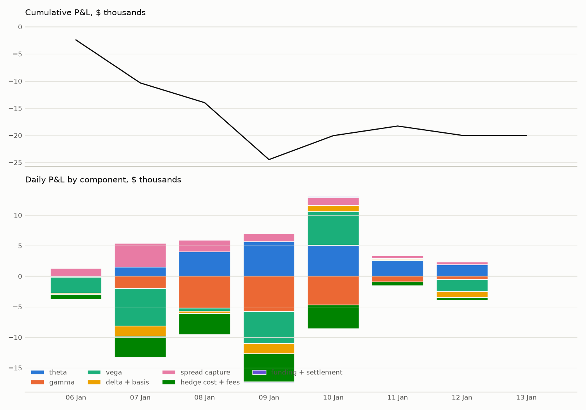
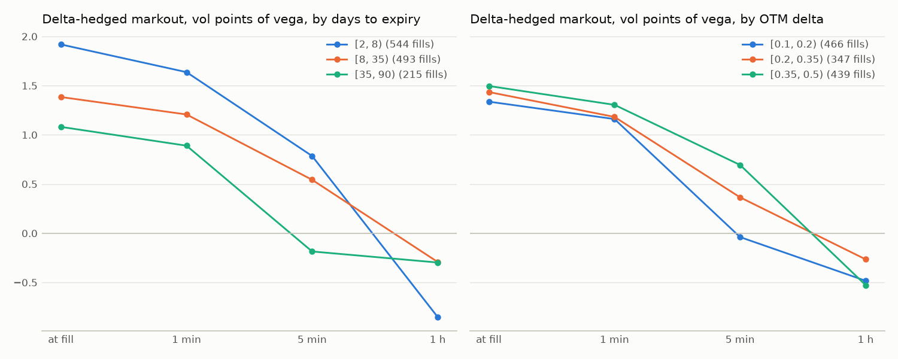
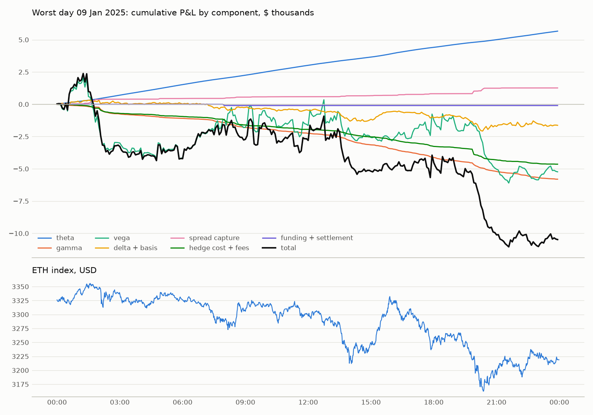

# P&L attribution, run 2025-01-06_2025-01-13

Generated by `uv run python -m mm.pnl.report --config config/base.yaml --run 2025-01-06_2025-01-13`.
All amounts in USD. Valuation at Surface A on information up to and including each
moment (D039). Waterfall per interval, in the order time → spot → basis → vol; flows at
each fill, hedge, expiry and funding (see `src/mm/pnl/attribution.py`).

## Reconciliation

- The replayed account (from fills, hedges and the ledger) matches the engine at every
  daily snapshot: max |ΔW| $0.0000, max |ΔB| 5.97e-13 ETH,
  max |ΔQ| $0.00e+00, position-count mismatches 0.
- Start value $181,778 (the 50 ETH collateral), end
  $161,785.
- Residual: $-0.0000, i.e. 0.000000% of gross P&L
  ($82,560).

## Components

| component | USD |
|---|---|
| theta | 20,615 |
| delta | -1,949 |
| gamma | -19,352 |
| basis | -1,562 |
| vega | -10,947 |
| spread_capture | 10,653 |
| hedge_cost | -3,858 |
| option_fee | -3,903 |
| perp_fee | -9,614 |
| delivery_fee | -65 |
| funding | -26 |
| settlement | 15 |
| **sum of components** | -19,994 |
| residual (engine total − sum) | -0 |
| **total (engine valuation)** | -19,994 |

Spread capture is measured against fair value at the fill (inclusive). The logged edge
against the quote's own fair value is $10,672; the difference
($19) is what the quote lost to staleness (latency
0 ms, refit interval, index moves since the quote's inputs).

## By day

| day | theta | delta | gamma | basis | vega | spread_capture | hedge_cost | option_fee | perp_fee | delivery_fee | funding | settlement | total |
|---|---|---|---|---|---|---|---|---|---|---|---|---|---|
| 01-06 | -79 | -145 | -109 | 1 | -2,615 | 1,304 | -110 | -462 | -222 | 0 | 11 | 0 | -2,428 |
| 01-07 | 1,477 | -1,340 | -2,000 | -318 | -6,178 | 3,932 | -954 | -1,414 | -1,121 | 0 | -5 | 0 | -7,922 |
| 01-08 | 4,021 | 90 | -5,226 | -466 | -508 | 1,920 | -818 | -650 | -2,005 | 0 | -1 | 9 | -3,634 |
| 01-09 | 5,665 | -980 | -5,805 | -652 | -5,236 | 1,264 | -911 | -460 | -3,271 | 0 | -3 | -95 | -10,484 |
| 01-10 | 5,109 | 1,093 | -4,733 | -56 | 5,447 | 1,285 | -937 | -519 | -2,378 | -65 | -1 | 165 | 4,410 |
| 01-11 | 2,563 | 117 | -950 | 66 | 153 | 460 | -72 | -200 | -348 | 0 | -2 | -17 | 1,770 |
| 01-12 | 1,858 | -784 | -529 | -147 | -2,009 | 488 | -56 | -198 | -270 | 0 | -25 | -47 | -1,717 |
| 01-13 | 1 | 1 | -0 | 9 | 0 | 0 | 0 | 0 | 0 | 0 | 0 | 0 | 11 |

## Markouts (per fill, D039)

| horizon | delta-hedged $ | raw $ | fills |
|---|---|---|---|
| 0 | 10,653 | 10,653 | 1,252 |
| 1min | 9,119 | 6,274 | 1,252 |
| 5min | 3,044 | -1,792 | 1,252 |
| 1h | -3,215 | -3,753 | 1,248 |

Delta-hedged markout by expiry (USD, and vol points of the fills' vega):

| bucket | fills | 0 $ | 0 vp | 1min $ | 1min vp | 5min $ | 5min vp | 1h $ | 1h vp |
|---|---|---|---|---|---|---|---|---|---|
| [2, 8) | 544 | 3,567.77 | 1.92 | 3,044.39 | 1.64 | 1,459.56 | 0.78 | -1,583.70 | -0.85 |
| [8, 35) | 493 | 4,962.87 | 1.38 | 4,327.71 | 1.21 | 1,947.54 | 0.54 | -1,047.34 | -0.29 |
| [35, 90) | 215 | 2,122.21 | 1.08 | 1,747.18 | 0.89 | -363.43 | -0.19 | -583.56 | -0.30 |

By OTM delta:

| bucket | fills | 0 $ | 0 vp | 1min $ | 1min vp | 5min $ | 5min vp | 1h $ | 1h vp |
|---|---|---|---|---|---|---|---|---|---|
| [0.1, 0.2) | 466 | 2,429.19 | 1.34 | 2,108.12 | 1.16 | -70.58 | -0.04 | -877.25 | -0.48 |
| [0.2, 0.35) | 347 | 3,342.72 | 1.43 | 2,754.26 | 1.18 | 850.54 | 0.37 | -618.06 | -0.27 |
| [0.35, 0.5) | 439 | 4,880.94 | 1.50 | 4,256.90 | 1.31 | 2,263.71 | 0.69 | -1,719.29 | -0.53 |

## Worst day: 09 Jan 2025 (total $-10,484)

144 fills (spread capture $1,264), 359
hedges (hedge cost $-911, perp fees $-3,271).

By hour (UTC):

| hour | theta | gamma | vega | delta + basis | spread capture | hedge cost + fees | funding + settlement | total | ETH close |
|---|---|---|---|---|---|---|---|---|---|
| 00:00 | 194 | -106 | 1,153 | 183 | 29 | -59 | -0 | 1,394 | 3,341 |
| 01:00 | 216 | -116 | -2,098 | 19 | 331 | -249 | -0 | -1,897 | 3,345 |
| 02:00 | 273 | -514 | -2,028 | -43 | 32 | -383 | -1 | -2,663 | 3,339 |
| 03:00 | 270 | -126 | -654 | -99 | 4 | -69 | -1 | -675 | 3,324 |
| 04:00 | 269 | -142 | 574 | 53 | 48 | -113 | -0 | 690 | 3,339 |
| 05:00 | 280 | -86 | -1,119 | -54 | 1 | -73 | -1 | -1,052 | 3,327 |
| 06:00 | 264 | -72 | 1,961 | -65 | 7 | -72 | -0 | 2,023 | 3,315 |
| 07:00 | 237 | -246 | 978 | -226 | 1 | -136 | -0 | 608 | 3,287 |
| 08:00 | 227 | -382 | -571 | -24 | 99 | -449 | -95 | -1,194 | 3,307 |
| 09:00 | 262 | -134 | 1,322 | -47 | 21 | -97 | -0 | 1,328 | 3,317 |
| 10:00 | 254 | -166 | -979 | -105 | 10 | -134 | -0 | -1,120 | 3,310 |
| 11:00 | 252 | -141 | -91 | -21 | 2 | -112 | -0 | -110 | 3,300 |
| 12:00 | 231 | -153 | 208 | -147 | 1 | -77 | -0 | 63 | 3,293 |
| 13:00 | 211 | -392 | -476 | -607 | 65 | -282 | -0 | -1,482 | 3,220 |
| 14:00 | 198 | -352 | -613 | -52 | 11 | -223 | -0 | -1,032 | 3,250 |
| 15:00 | 257 | -312 | -282 | 650 | 30 | -222 | -0 | 121 | 3,319 |
| 16:00 | 274 | -296 | 106 | -56 | 71 | -241 | 0 | -144 | 3,302 |
| 17:00 | 222 | -360 | 1,850 | -323 | 55 | -244 | -0 | 1,200 | 3,250 |
| 18:00 | 218 | -250 | -161 | 89 | 3 | -97 | -0 | -198 | 3,260 |
| 19:00 | 194 | -335 | -757 | -685 | 197 | -555 | 0 | -1,942 | 3,195 |
| 20:00 | 183 | -502 | -3,266 | -94 | 227 | -408 | -0 | -3,860 | 3,195 |
| 21:00 | 227 | -196 | -330 | 2 | 17 | -132 | -0 | -412 | 3,208 |
| 22:00 | 226 | -283 | -582 | 180 | 2 | -144 | 0 | -600 | 3,225 |
| 23:00 | 226 | -146 | 620 | -160 | 0 | -70 | 0 | 470 | 3,219 |

The 10 fills with the worst 1-hour delta-hedged markout:

| ts_ms | instrument_name | our_side | qty | hedged_0 | hedged_5min | hedged_1h |
|---|---|---|---|---|---|---|
| 20:24:11 | ETH-17JAN25-3250-C | sell | 12 | 25 | -22 | -77 |
| 20:23:17 | ETH-17JAN25-3200-C | sell | 12 | 25 | -26 | -74 |
| 20:24:54 | ETH-17JAN25-3200-C | sell | 12 | 39 | -11 | -67 |
| 20:24:57 | ETH-17JAN25-3300-C | sell | 12 | 35 | -4 | -56 |
| 01:38:15 | ETH-11JAN25-3425-C | sell | 12 | 24 | 14 | -53 |
| 01:37:15 | ETH-11JAN25-3425-C | sell | 12 | 28 | 20 | -47 |
| 16:44:47 | ETH-24JAN25-3000-P | buy | 12 | 21 | -1 | -44 |
| 00:49:36 | ETH-28MAR25-5000-C | buy | 6 | 26 | -22 | -38 |
| 01:41:52 | ETH-11JAN25-3425-C | sell | 12 | 26 | 13 | -37 |
| 04:55:14 | ETH-28MAR25-5500-C | buy | 8 | 20 | -33 | -35 |

