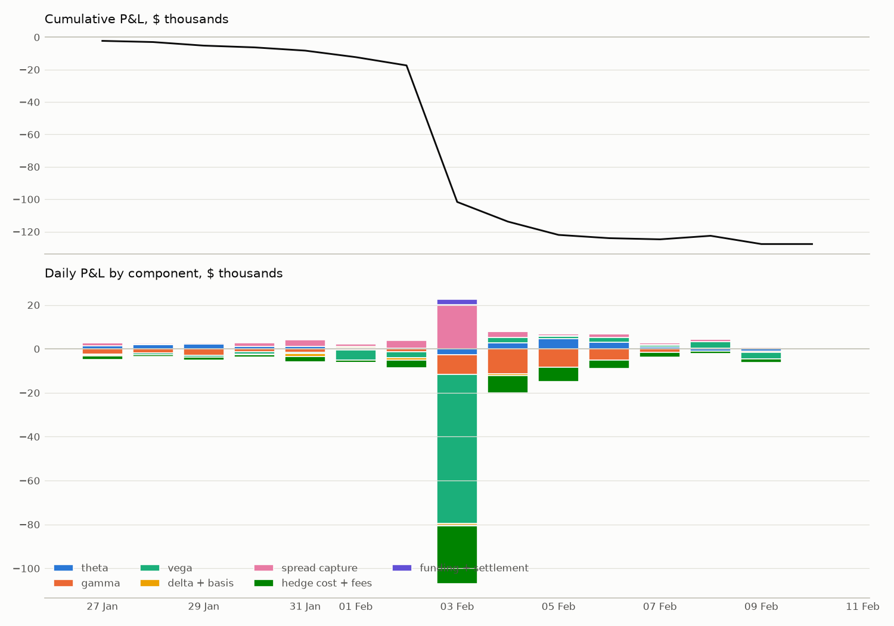
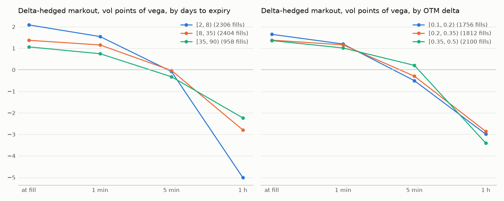
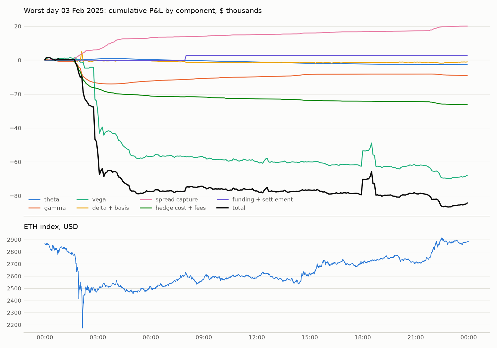

# P&L attribution, run 2025-01-27_2025-02-10

Generated by `uv run python -m mm.pnl.report --config config/base.yaml --run 2025-01-27_2025-02-10`.
All amounts in USD. Valuation at Surface A on information up to and including each
moment (D039). Waterfall per interval, in the order time → spot → basis → vol; flows at
each fill, hedge, expiry and funding (see `src/mm/pnl/attribution.py`).

## Reconciliation

- The replayed account (from fills, hedges and the ledger) matches the engine at every
  daily snapshot: max |ΔW| $0.0000, max |ΔB| 2.48e-12 ETH,
  max |ΔQ| $0.00e+00, position-count mismatches 0.
- Start value $161,624 (the 50 ETH collateral), end
  $33,990.
- Residual: $0.0000, i.e. 0.000000% of gross P&L
  ($243,096).

## Components

| component | USD |
|---|---|
| theta | 15,714 |
| delta | -2,431 |
| gamma | -47,713 |
| basis | -1,403 |
| vega | -72,337 |
| spread_capture | 39,192 |
| hedge_cost | -18,986 |
| option_fee | -13,152 |
| perp_fee | -28,918 |
| delivery_fee | -254 |
| funding | -171 |
| settlement | 2,825 |
| **sum of components** | -127,633 |
| residual (engine total − sum) | 0 |
| **total (engine valuation)** | -127,633 |

Spread capture is measured against fair value at the fill (inclusive). The logged edge
against the quote's own fair value is $38,617; the difference
($-575) is what the quote lost to staleness (latency
0 ms, refit interval, index moves since the quote's inputs).

## By day

| day | theta | delta | gamma | basis | vega | spread_capture | hedge_cost | option_fee | perp_fee | delivery_fee | funding | settlement | total |
|---|---|---|---|---|---|---|---|---|---|---|---|---|---|
| 01-27 | 1,318 | -426 | -2,439 | -202 | -126 | 1,347 | -348 | -570 | -824 | 0 | 4 | 0 | -2,267 |
| 01-28 | 1,984 | 362 | -1,874 | -75 | -848 | 407 | -133 | -128 | -425 | 0 | 1 | 0 | -731 |
| 01-29 | 2,330 | -94 | -2,880 | -149 | -751 | 560 | -210 | -213 | -833 | 0 | -3 | 43 | -2,199 |
| 01-30 | 1,184 | -124 | -1,231 | 43 | -1,296 | 1,504 | -187 | -500 | -438 | 0 | -26 | -25 | -1,095 |
| 01-31 | 1,028 | -978 | -1,711 | -318 | -420 | 2,964 | -414 | -1,032 | -958 | -19 | -49 | -86 | -1,992 |
| 02-01 | 614 | 108 | -563 | 390 | -4,641 | 1,193 | -77 | -566 | -455 | 0 | -13 | -18 | -4,027 |
| 02-02 | 436 | -693 | -1,435 | -447 | -2,664 | 3,436 | -794 | -1,325 | -1,322 | 0 | -54 | -244 | -5,105 |
| 02-03 | -2,561 | -1,417 | -9,102 | 332 | -67,897 | 20,018 | -12,004 | -5,991 | -8,273 | 0 | -415 | 3,058 | -84,252 |
| 02-04 | 2,844 | 509 | -11,246 | -1,344 | 2,271 | 2,747 | -1,833 | -1,075 | -5,012 | 0 | 20 | -2 | -12,120 |
| 02-05 | 4,606 | 442 | -8,329 | -181 | 1,107 | 814 | -1,321 | -253 | -5,104 | 0 | 50 | -46 | -8,214 |
| 02-06 | 3,047 | 271 | -5,033 | -326 | 2,243 | 1,434 | -785 | -432 | -2,489 | 0 | 61 | -5 | -2,014 |
| 02-07 | 781 | -158 | -1,605 | 435 | 860 | 948 | -405 | -396 | -1,192 | -235 | 148 | 102 | -717 |
| 02-08 | -945 | -204 | 332 | 183 | 2,915 | 1,111 | -157 | -377 | -687 | 0 | 4 | 7 | 2,182 |
| 02-09 | -953 | -27 | -597 | 243 | -3,089 | 710 | -315 | -294 | -906 | 0 | 98 | 40 | -5,090 |
| 02-10 | -0 | -4 | -0 | 14 | 0 | 0 | 0 | 0 | 0 | 0 | 0 | 0 | 9 |

## Markouts (per fill, D039)

| horizon | delta-hedged $ | raw $ | fills |
|---|---|---|---|
| 0 | 39,192 | 39,192 | 5,668 |
| 1min | 30,286 | 19,085 | 5,668 |
| 5min | -3,792 | -24,754 | 5,667 |
| 1h | -85,133 | -104,942 | 5,667 |

Delta-hedged markout by expiry (USD, and vol points of the fills' vega):

| bucket | fills | 0 $ | 0 vp | 1min $ | 1min vp | 5min $ | 5min vp | 1h $ | 1h vp |
|---|---|---|---|---|---|---|---|---|---|
| [2, 8) | 2306 | 13,167.08 | 2.09 | 9,741.65 | 1.54 | -497.10 | -0.08 | -31,577.79 | -5.01 |
| [8, 35) | 2404 | 16,360.76 | 1.37 | 13,767.68 | 1.15 | -368.19 | -0.03 | -33,286.37 | -2.79 |
| [35, 90) | 958 | 9,664.28 | 1.06 | 6,776.38 | 0.75 | -2,926.82 | -0.32 | -20,268.75 | -2.23 |

By OTM delta:

| bucket | fills | 0 $ | 0 vp | 1min $ | 1min vp | 5min $ | 5min vp | 1h $ | 1h vp |
|---|---|---|---|---|---|---|---|---|---|
| [0.1, 0.2) | 1756 | 10,772.05 | 1.65 | 7,836.84 | 1.20 | -3,298.06 | -0.50 | -19,532.45 | -2.99 |
| [0.2, 0.35) | 1812 | 13,073.82 | 1.38 | 10,994.53 | 1.16 | -2,821.16 | -0.30 | -27,126.73 | -2.86 |
| [0.35, 0.5) | 2100 | 15,346.24 | 1.36 | 11,454.34 | 1.01 | 2,327.11 | 0.21 | -38,473.73 | -3.41 |

## Worst day: 03 Feb 2025 (total $-84,252)

2,660 fills (spread capture $20,018), 1,038
hedges (hedge cost $-12,004, perp fees $-8,273).

By hour (UTC):

| hour | theta | gamma | vega | delta + basis | spread capture | hedge cost + fees | funding + settlement | total | ETH close |
|---|---|---|---|---|---|---|---|---|---|
| 00:00 | 147 | -730 | 993 | 67 | 254 | -399 | -2 | 330 | 2,823 |
| 01:00 | 136 | -3,411 | -1,412 | -262 | 2,327 | -5,338 | -9 | -7,970 | 2,487 |
| 02:00 | 333 | -9,344 | -23,699 | -221 | 3,398 | -10,863 | -0 | -40,396 | 2,488 |
| 03:00 | 330 | -561 | -19,034 | -39 | 4,685 | -2,852 | -170 | -17,641 | 2,528 |
| 04:00 | -309 | 837 | -13,216 | 65 | 1,962 | -879 | -27 | -11,567 | 2,454 |
| 05:00 | -327 | 836 | -319 | 39 | 425 | -794 | -1 | -140 | 2,517 |
| 06:00 | -271 | 527 | 252 | -413 | 502 | -355 | 3 | 246 | 2,527 |
| 07:00 | -230 | 393 | -279 | -198 | 237 | -213 | 1 | -289 | 2,624 |
| 08:00 | -225 | 557 | -44 | -427 | 256 | -98 | 3,055 | 3,074 | 2,575 |
| 09:00 | -230 | 516 | -1,969 | 31 | 430 | -461 | -8 | -1,690 | 2,573 |
| 10:00 | -231 | 285 | -578 | 7 | 374 | -413 | -2 | -559 | 2,612 |
| 11:00 | -240 | 192 | -456 | 5 | 160 | -188 | -6 | -531 | 2,584 |
| 12:00 | -249 | 246 | -407 | 77 | 171 | -109 | -8 | -280 | 2,584 |
| 13:00 | -268 | 298 | 2 | -83 | 176 | -229 | -24 | -127 | 2,579 |
| 14:00 | -237 | 876 | 225 | 62 | 578 | -500 | -14 | 990 | 2,624 |
| 15:00 | -155 | 162 | -1,439 | -247 | 323 | -298 | -8 | -1,662 | 2,705 |
| 16:00 | -121 | 10 | -48 | 13 | 395 | -202 | -28 | 19 | 2,710 |
| 17:00 | -146 | 70 | -1,145 | 27 | 41 | -24 | -32 | -1,209 | 2,712 |
| 18:00 | -133 | -1 | -258 | -33 | 181 | -92 | -21 | -357 | 2,737 |
| 19:00 | -86 | -5 | -1,001 | 111 | 136 | -86 | -18 | -949 | 2,770 |
| 20:00 | -113 | 8 | 2,285 | 270 | 238 | -91 | -22 | 2,577 | 2,708 |
| 21:00 | -120 | 18 | -3,768 | -348 | 486 | -303 | -17 | -4,052 | 2,820 |
| 22:00 | 80 | -658 | -4,441 | -15 | 1,951 | -1,249 | -1 | -4,333 | 2,871 |
| 23:00 | 102 | -224 | 1,859 | 427 | 333 | -236 | 3 | 2,263 | 2,883 |

The 10 fills with the worst 1-hour delta-hedged markout:

| ts_ms | instrument_name | our_side | qty | hedged_0 | hedged_5min | hedged_1h |
|---|---|---|---|---|---|---|
| 02:07:44 | ETH-7FEB25-2200-P | sell | 12 | 25 | -494 | -1,112 |
| 01:38:39 | ETH-14FEB25-2800-P | sell | 12 | 39 | 24 | -780 |
| 01:44:03 | ETH-21FEB25-2700-P | sell | 10 | 26 | -59 | -683 |
| 01:45:56 | ETH-5FEB25-2750-P | sell | 12 | 24 | -72 | -640 |
| 02:07:49 | ETH-7FEB25-2300-P | sell | 5 | -2 | -264 | -592 |
| 02:07:43 | ETH-7FEB25-2400-P | sell | 5 | 10 | -201 | -586 |
| 02:07:43 | ETH-7FEB25-2400-P | sell | 5 | 10 | -201 | -586 |
| 01:45:59 | ETH-21FEB25-2600-P | sell | 11 | 41 | 20 | -575 |
| 01:45:59 | ETH-7FEB25-2800-P | sell | 12 | 19 | 8 | -512 |
| 02:08:16 | ETH-7FEB25-2400-P | sell | 4 | 6 | -189 | -497 |

