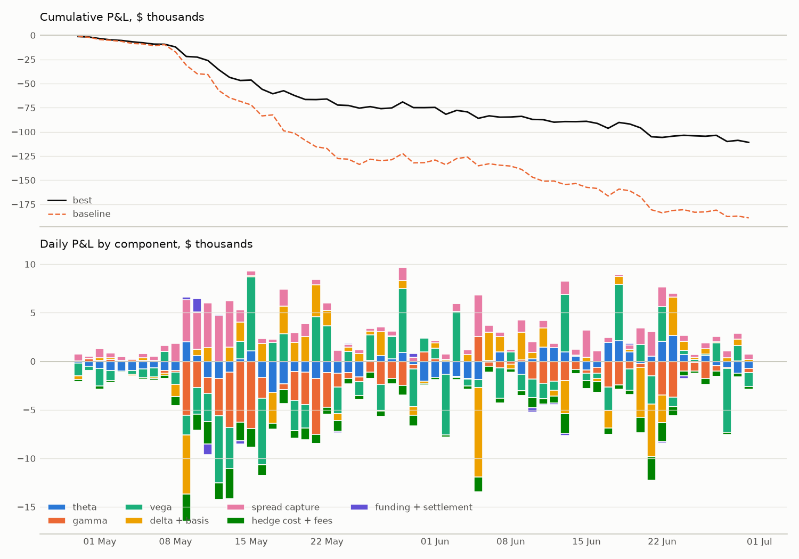
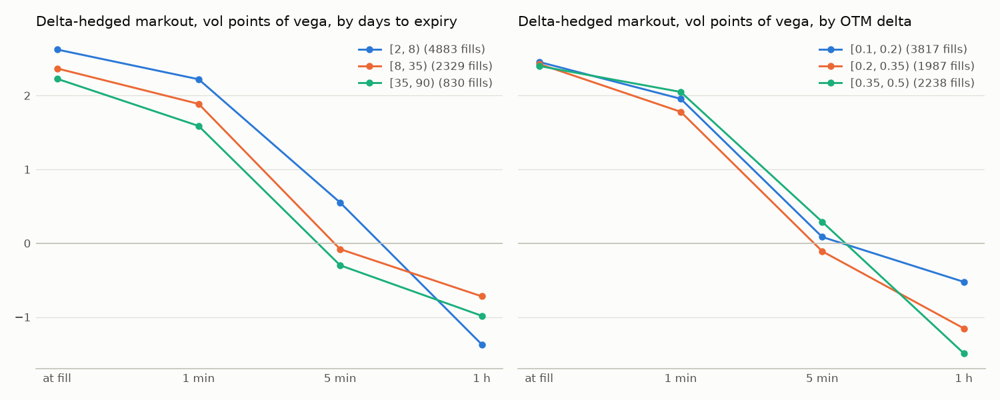
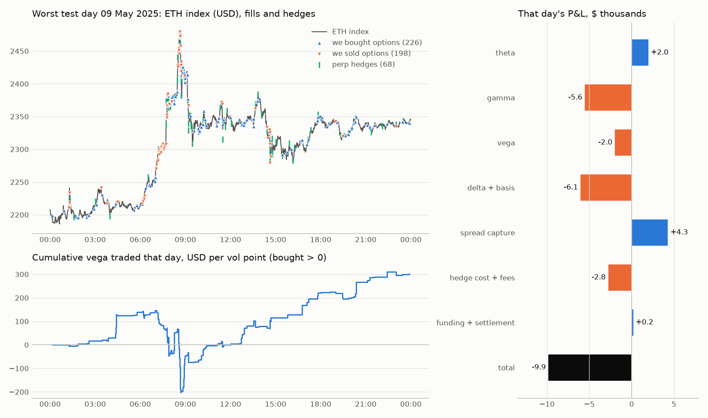

# Market-making ETH options on Deribit: a historical simulation

*Research note, Phase 9. All results are on the out-of-sample test period, 29 April – 30 June 2025 (63 days). Every result number comes from one command (see [Reproduce](#reproduce)).*

## 1. Question and short answer

**Question.** A market maker quotes ETH options on Deribit around a fitted vol surface, gets filled by real historical trades, and delta-hedges with the perpetual. Which quoting and risk choices make money after adverse selection, hedging costs and fees, and why?

**Short answer.** None of the settings tested makes money. The best setting, chosen on the training period, loses $111k on the test period against $189k for the baseline. Both lose more than the account's starting capital (50 ETH ≈ $90k on 29 April); the simulator has no margin model, so it keeps quoting after the equity is gone (section 3).

- **Why.** Our fills enter with a real edge of 1.1–2.4 vol points against the market's fair value. Within an hour, the delta-hedged markout turns to −0.4 to −1.1 vol points. The takers who trade with us are informed about the next hour's move, and the short gamma and hedging costs that come with their flow exceed the spread we capture.
- **What helps.** Trading less: a wider spread (+$991 ± 603 per day against the baseline) and a wider hedge band (+$348 ± 102 per day).
- **What doesn't.** Inventory skew changes which risk the book holds but not what it earns, and one second of latency costs little at these spreads.

## 2. Setup

**Data.** Deribit's public history API, 1 January – 30 June 2025:
- 1.69M option trades, after removing 16,082 block trades and 7,392 combo legs;
- 19.5M perpetual trades, 6.0M dated-future trades, hourly funding, delivery prices and DVOL.

The data is in `reports/phase1_data.md`.

**Pricing.** Black-76, undiscounted. The ETH premium is C/F, and the forward is F = basis × index, with the basis taken from the dated futures and interpolated in ln between them (D017). Our implied vols reproduce Deribit's trade IVs with a median error of 0.013 vol points (p95 0.142) for expiries over 4 days, and 97.2% of trades price within half a tick (`reports/phase2_validation.md`).

**Surface A (the market's fair value).**
- An eSSVI slice per expiry, fitted every 5 minutes to Deribit mark IVs from a trailing 60-minute window; it is butterfly-free by construction and calendar-constrained (D020–D026).
- Median fit error is 0.16–1.06 vol points depending on expiry, and 99.1% of refits on normal days are arbitrage-free.
- The 30-day ATM vol tracks DVOL (daily-change correlation 0.858) (`reports/phase3_surface.md`).
- Between refits the surface is held in log-moneyness.

**Quoter** (D030–D035).
- **Universe:** expiries of 2–90 days and strikes with OTM delta ≥ 0.10.
- **Spread:** bid and ask at fair vol ∓ a half-spread h, with a minimum width of one tick or the maker fee; bids are rounded down and asks up.
- **Skew:** both quotes shift by −κ · net vega / vega limit, capped at ±h.
- **Size:** $50 of vega per quote, capped at 25 contracts.

**Fills (strict, D003, D027).** A taker sell at price p fills our bid only if bid > p, and a taker buy fills our ask only if ask < p. The fill is 50% of min(trade size, our size), at our price, and pays the maker fee. Quotes use only information from before trade time − latency.

**Hedging and limits** (D034–D036, D041, D043).
- **Account delta:** B + Σ nᵢ·N(d1ᵢ) + Q/P0, collateral included.
- **Hedge rule:** when |delta| exceeds the band (5 ETH), hedge back to zero with the inverse perpetual as a taker. The order fills at the first same-side perp print at or after decision + latency, plus 1 bp and the 0.05% taker fee.
- **Limits:** net vega $2,000, cash gamma $115 per 1% move, 100 contracts per instrument. Each quote side is cut to the room left.

**Attribution** (D039).
- The account is revalued at Surface A every minute and at every event. Each step is split in the fixed order time → spot (delta, gamma) → basis → vol.
- The flows are spread capture, hedge cost, fees, funding and settlement.
- An independent replay of the account from the logs matches the engine, and the components sum to the total with a residual of about 1e-9 USD on every test run.

**Design** (D042).
- **Periods:** parameters are chosen on the training period (1 January – 28 April, 65% of days) by mean daily P&L, and reported on the test period. The stress-day threshold (daily mean DVOL ≥ 72.0, the training 80th percentile) also comes from training.
- **Comparison:** each variant is compared with the baseline by paired daily P&L differences, mean ± 2 standard errors over 63 days. The lag-1 autocorrelation is shown as a warning when the error bar may be too narrow.
- **Grid:** small on purpose, 14 runs, to fit an 8 GB laptop.
  - spread h ∈ {0.5, **1**, 2};
  - skew κ ∈ {0, **1**};
  - band ∈ {**5**, 10} ETH;
  - latency ∈ {**0**, 1 s};
  - robustness: stricter and looser fills.

## 3. Simplifications

These matter for how far the numbers can be trusted:

- **No order book or queue.** We assume our quote is resting and visible whenever a trade prints through it. The strict trade-through rule and 50% fill fraction are the guard against flattering fills; the robustness runs vary that guard.
- **We never move the market.** Trades that filled us would have happened anyway, at the same prices.
- **No margin.** The account can go below zero and keep trading, and it does. The baseline's cumulative loss exceeds starting capital on 18 May and the best setting's on 16 June. A real account would have been liquidated, so the dollar losses after those dates are hypothetical. The paired comparisons, which ask which setting loses less on the same days, are unaffected.
- **Fixed absolute limits.** The vega and gamma limits are in dollars and do not shrink as equity falls.
- **No active risk reduction.** The book only stops adding risk at a limit; it never trades out. Gamma rises on its own toward expiry, so the gamma limit is exceeded on average (mean |gamma| 68–124% of the limit across variants).
- **Lean grid.** Fixed-size and random-whole-contract sizing, a 5 s latency and the extra grid values were dropped (D042). The baseline was not run under the alternative fill models.

## 4. Results

| variant | total P&L | per day | Δ vs baseline per day (± 2 se) | fills | hedges | 1 h markout (vol pts) |
|---|---|---|---|---|---|---|
| **baseline** (h 1, κ 1, band 5) | −$189,059 | −$3,001 | | 13,360 | 7,846 | −0.85 |
| spread 0.5 | −$219,192 | −$3,479 | −$478 ± 443 | 16,916 | 9,571 | −0.70 |
| spread 2 | −$126,616 | −$2,010 | **+$991 ± 603** | 7,740 | 5,663 | −1.06 |
| skew off (κ 0) | −$189,147 | −$3,002 | −$1 ± 564 | 13,511 | 6,792 | −0.89 |
| band 10 ETH | −$167,146 | −$2,653 | **+$348 ± 102** | 13,360 | 2,534 | −0.85 |
| latency 1 s | −$198,699 | −$3,154 | −$153 ± 172 | 13,553 | 8,090 | −0.86 |
| **best** (h 2, κ 0, band 10) | −$110,881 | −$1,760 | **+$1,241 ± 908** | 8,042 | 1,439 | −1.02 |
| best, stricter fills (25%) | −$59,195 | −$940 | *(fill model differs)* | 9,157 | 839 | −1.01 |
| best, looser fills (100% + ½ at price) | −$199,384 | −$3,165 | *(fill model differs)* | 14,328 | 3,008 | −0.42 |

The full table, with Sharpe, drawdown, calm and stress splits, components and the training selection, is in `reports/phase8_results.md`.

**Selection carried over for spread and band, not for skew.** On training, spread 2 beat 1 by $929 per day and band 10 beat 5 by $248 per day, and both kept their sign on test. Skew-off won on training by $336 per day and was worth nothing on test.



*Figure 1. Top: cumulative P&L of the best setting (solid) and the baseline (dashed). Bottom: the best setting's daily P&L by component. The loss is steady rather than one blow-up. 60% of it (−$66.6k) comes between 8 and 21 May, when ETH rallied from about $1,800 to $2,700.*

Over the test period, the best setting's spread capture (+$70k) and theta (−$22k) are outweighed by gamma (−$88k), hedging and fees (−$53k) and vega (−$19k). The baseline's −$166k of gamma is the single biggest line in the table.

**Mechanisms**

- **Spread.** Doubling h halves the fills but keeps 88% of the spread capture, because the edge per fill rises from 1.49 to 2.43 vol points. The smaller inventory cuts the gamma loss by $44k and hedging and fees by $37k. The gain is larger on stress days (+$1,599 against +$642 per day, both with wide error bars). Wide-spread fills are more toxic per unit of vega (1 h markout −1.06 against −0.85), so the gain comes from trading less, not from better trades.
- **Band.** The fills are the same. Hedges fall by two thirds, saving $30k of taker fees and spread, at a cost of about $8k in extra delta and gamma noise. This is the most precise result. Its lag-1 autocorrelation of 0.38 widens the honest error bar to about ±150, which is still clearly positive.
- **Skew.** With κ = 1 the book stays short options (theta +$18k, gamma −$166k). With κ = 0 it drifts long vega (mean |vega| 48% of the limit against 18%), pays theta (−$25k) and loses less on gamma (−$129k). The two offset.
- **Latency.** A 1 s delay lowers the edge at fill from 1.49 to 1.40 vol points, and stale quotes are picked off on underlying moves (delta and basis go from +$16k to −$4k). The total effect (−$153 ± 172 per day) is not distinguishable from zero.
- **Fill model.** The loss scales with volume: −$59k with stricter fills, −$199k with looser ones. The sign of the conclusion does not depend on the fill assumption. Looser fills improve the 1 h markout (−0.42), because the extra fills at exactly our price come from less-informed flow.

## 5. Where the money goes: adverse selection



*Figure 2. Delta-hedged markout of the best setting's fills, as side × (fair value later − fill price) − delta × the index move, in vol points of the vega filled. At fill this is our edge. It falls through zero within about 5 minutes and is negative by 1 hour in every bucket.*

This is the core result. Measured at the moment of the fill, every bucket shows 2.2–2.6 vol points of edge. One hour later, after removing the part explained by the ETH move we hedged:

| bucket | fills | edge at fill | 1 h markout |
|---|---|---|---|
| 2–8 days | 4,883 | +2.62 | −1.37 |
| 8–35 days | 2,329 | +2.37 | −0.72 |
| 35–90 days | 830 | +2.23 | −0.98 |
| OTM delta 0.10–0.20 | 3,817 | +2.45 | −0.52 |
| OTM delta 0.20–0.35 | 1,987 | +2.43 | −1.15 |
| OTM delta 0.35–0.50 | 2,238 | +2.40 | −1.49 |

The flow that trades through our quotes predicts where the surface goes next. It is most informed in short-dated and near-the-money options, where gamma is largest. A quoter that prices every taker the same pays for this. The markout makes it visible at the fill level long before it shows in daily P&L.

## 6. The worst day: 9 May 2025



*Figure 3. The best setting on its worst test day (−$9.9k). Left: the ETH index with our fills (▲ we bought, ▼ we sold) and perpetual hedges, and below it the cumulative vega we traded. Right: the day's P&L by component.*

ETH ran from about $2,210 to $2,480 between 06:30 and 08:45 UTC and then gave half of it back.

- **Into the rally:** takers bought options from us. From 07:00 to 09:00 we sold about $340 of vega, going from $140 net bought to $200 net sold, so the book was short gamma into a 12% move.
- **Hedging:** with a 10 ETH band the hedger lets delta build before acting. A short-gamma book gets shorter delta as the price rises, so each hedge bought perp after part of the move had happened and paid the taker fee. The day's delta and basis (−$6.1k) and gamma (−$5.6k) lines are the cost.
- **The rest of the day:** quieter. We bought vega back through the afternoon and ended the day $300 net bought, and spread capture (+$4.3k) and theta (+$2.0k) recovered part of the loss.

The day shows the whole mechanism in one place: an informed, one-directional flow; short gamma; and hedges that are always one move late.

The note keeps daily components for this chart (Phase 9 option B, no rerun). An hour-by-hour component split would need the run's intraday attribution, which `mm.pnl.report` produces for any run saved by `mm.run`.

## 7. What I learned

1. **Edge at the fill is not edge.** Every fill looked profitable when it happened. Only delta-hedged markouts at a horizon, and P&L attribution that reconciles to the cent, show that it isn't. A simulator that reported only spread capture would have called this strategy a success.
2. **Here, the real decision is how much to trade.** Both choices that helped reduce exposure to informed flow and its hedging cost. Choices that only reshape the book (skew) or slightly freshen quotes (latency) did not move the result.
3. **Hedging cost is first-order.** At a 5 ETH band, hedging and fees ($118k) were 1.5× the spread capture ($78k). The band is a trade-off between fee drag and unhedged gamma, and at these fees a wider band wins.
4. **The validation scaffolding paid for itself.** Silent errors were found by checks, not by looking at P&L:
   - same-millisecond trades in undefined order were caught by a hand-check (D044);
   - a NaN start value silently read as zero was caught by the batch summary (D045);
   - seconds read as milliseconds in this note's own figures were caught by a unit test.
   The reconciling replay (residual about 1e-9 USD) is what makes the component numbers trustworthy.
5. **Train-to-test selection is noisy at this sample size.** 63 test days give error bars of $400–900 per day on most comparisons. Only the hedge band result is precise, and skew-off's training win vanished on test.

## 8. Next steps

Ordered by what the results point to (from `reports/extensions.md` and the decisions log):

1. **Price the flow, not just the option.** Widen or skew quotes using what predicts the markouts: expiry, delta, trade size, recent one-way flow and fast-market regimes. A calibrated, regime-dependent spread is the natural next experiment.
2. **Actively reduce risk.** Trade out of short-dated short-gamma inventory instead of only cutting new quotes, and add risk-reversal and tenor-bucket vega limits. Net vega hides offsetting put and call risk.
3. **Margin and equity-relative limits,** so that the account stops when it would be liquidated and risk scales with equity.
4. **A hedge-policy comparison:** fixed interval, Whalley–Wilmott band, and dated futures for long expiries.
5. **Faster surface refits in fast markets.** On days like 9 May the 5-minute surface lags the move.
6. **The dropped grid values and robustness runs:** fixed sizing, 5 s latency, and the baseline under alternative fill models.

## Reproduce

```bash
uv sync
uv run python -m mm.data.cli download --config config/base.yaml   # once; cached under data/
uv run python -m mm.data.cli clean    --config config/base.yaml
uv run python -m mm.run --config config/base.yaml --experiments config/experiments.yaml
```

The last command runs the 14 simulations, then writes `reports/phase8_results.md` and the figures in `reports/figures/`, including this note's three. Each run is cached by a hash of its resolved config.

Known gap (D045): the five cached training runs predate a fix for the first second of 1 January. Their daily P&L differs from a fresh run by about $26 on day 1, the same in every variant, so the selection is unaffected. To regenerate them, delete `data/runs/exp/train/`.

The setup-validation numbers in section 2 come from `mm.pricing.validate` and `mm.surface.report`. Every modelling choice is logged with its alternative and category in `reports/decisions.md` (D001–D045).
